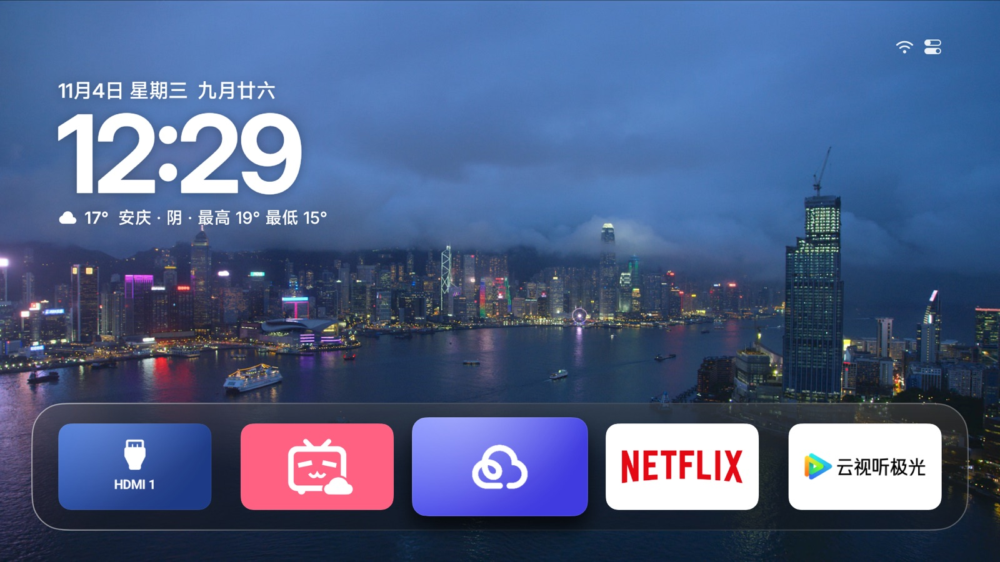

<!--
  klcb2010/aerial-tv
  基于 pengchujin/aerial-tv 的个人维护与功能增强版本
-->

# Aerial · klcb2010 魔改版

**给电视一个清爽、顺手、真正由自己掌控的主屏幕。**

基于上游 Aerial TV，保留原项目简洁优雅的 tvOS 风格体验，
并加入面向日常使用的功能增强、独立更新体系与稳定签名构建。

  
  
  
  

[立即下载](https://github.com/klcb2010/aerial-tv/releases/latest) ·
[版本记录](https://github.com/klcb2010/aerial-tv/releases) ·
[构建状态](https://github.com/klcb2010/aerial-tv/actions) ·
[上游项目](https://github.com/pengchujin/aerial-tv)

---

## 项目简介

这是基于 [pengchujin/aerial-tv](https://github.com/pengchujin/aerial-tv) 持续同步的个人增强版本。

Aerial 是一款面向 Android TV 的轻量桌面：没有广告和信息流，把应用、壁纸与屏保还给用户。本仓库在保留上游设计与核心能力的基础上，针对实际使用体验增加了一些定制功能，并维护独立的 APK 发布和应用内更新通道。

**本仓库是非官方衍生版本，不代表上游项目。** 上游原版请访问 [pengchujin/aerial-tv](https://github.com/pengchujin/aerial-tv)。

## 魔改功能

### 主屏幕布局增强

- **第一排隐藏不补位**：隐藏第一排应用后，可以保留原来的位置，不让后续应用自动顶上来。
- **移出第一排**：通过应用菜单将应用或文件夹快速移到下一排，同时保留原位置。
- **移动到第一排**：将应用或文件夹放回第一排时，优先填补最左侧的空位。
- **独立开关**：是否保留第一排空位可以在个性化设置中控制，默认关闭；不改变其他行原有的自动补位行为。
- **第一排玻璃底板透明度**：可按个人喜好调整底板透明程度。

### 酷开 / 创维电视兼容

- **酷开模式（默认关闭）**：在个性化设置中按需开启，专门适配部分创维 / 酷开系统对默认桌面和无障碍服务的特殊处理。
- **Aerial 桌面守护接管**：开启后不再通过“设置为默认桌面”入口注册默认桌面；点击该入口只显示说明，不会执行默认桌面注册。
- **无障碍配置增量同步**：后台定期检查 Aerial 桌面守护服务是否仍在系统无障碍启用列表中；缺失时只追加 Aerial 服务，保留酷开及其他已有服务，不覆盖原有配置。
- **异常重试与状态检查**：同步失败采用递增间隔重试，最长间隔为 5 分钟；服务已登记但未运行时，会限频检查并尝试重新绑定。
- **延迟接管**：酷开模式下，开机及解锁后的首次桌面接管会适当延迟，给系统桌面完成启动和检查留出时间。

> **首次启用说明：** Android 系统通常不允许普通应用静默开启无障碍服务。首次使用仍需进入电视系统的无障碍设置，手动启用“Aerial 桌面守护”；后台同步还依赖系统授予相应的安全设置写入权限。酷开模式不能保证在所有固件版本上都能自动恢复被系统主动限制的服务。

### 更新体验增强

- **独立更新通道**：应用内版本检测和 APK 下载指向本仓库发布的版本，不会误用上游版本。
- **手动检查更新**：设置中提供明确的检查更新入口，并显示检查中、已是最新、发现新版本或检查失败等结果。
- **自动检测开关**：可以单独关闭自动检测；关闭后仍可随时手动检查。
- **新版本提醒**：检测到新版本后显示提示，可选择立即前往更新或稍后处理。
- **稳定签名**：正式版使用固定签名证书，正常升级时可以直接覆盖安装，无须卸载旧版本。

> 以上为本仓库定制功能。上游原有功能和界面以原项目说明为准。

## 下载与安装

进入 [Releases 最新版本页](https://github.com/klcb2010/aerial-tv/releases/latest)，根据设备情况选择 APK：

| 安装包 | 说明 |
|---|---|
| <code>aerial-standard.apk</code> | 标准版，优先选择 |
| <code>aerial-guard.apk</code> | Guard 兼容版；标准版无法正常接管桌面时再尝试 |

安装与桌面接管方式沿用上游 Aerial 的说明，请参考 [上游安装指南](https://github.com/pengchujin/aerial-tv#install) 和 [设备适配文档](docs/devices/adb-by-brand.md)。

**升级提示：** 本仓库正式版采用固定签名。请从本仓库 Releases 下载后续版本，以便直接覆盖升级并保留应用数据。不要混装签名不同的第三方构建。

## 自动构建与发布

本仓库使用 GitHub Actions 自动完成上游同步、魔改注入、APK 构建、签名校验和 Release 发布。

1. **同步上游**：定时从上游 main 拉取更新，并同步到本仓库。
2. **保留定制内容**：同步时保护 README 文件、mod/、version.txt 和本仓库工作流目录，避免被上游覆盖。
3. **应用魔改补丁**：执行 mod/apply.py，将本仓库维护的定制功能注入上游源码。
4. **严格校验**：检查补丁锚点、关键功能标记和 Git diff；上游代码结构发生变化导致补丁无法安全应用时，构建会主动失败，而不是静默生成缺少功能的 APK。
5. **构建与签名**：自动构建 Standard / Guard 两个 Release APK，并验证签名证书指纹。
6. **发布更新**：构建成功后自动创建 GitHub Release，发布 APK，并更新应用内版本信息。

版本号由自动构建递增生成。每次正式发布都会使用同一套签名密钥，确保版本之间具备覆盖升级条件。

- [查看 GitHub Actions](https://github.com/klcb2010/aerial-tv/actions)
- [查看所有正式版本](https://github.com/klcb2010/aerial-tv/releases)
- [查看魔改补丁](mod/apply.py)

## 从源码构建

需要 JDK 17、Android SDK（API 36 / Build Tools 36.0.0）和 Python 3。

~~~bash
git clone https://github.com/klcb2010/aerial-tv.git
cd aerial-tv

# 将本仓库的定制补丁应用到当前源码
python3 mod/apply.py

# 构建 Standard 与 Guard Release
./gradlew --no-daemon assembleStandardRelease assembleGuardRelease
~~~

本地构建若要生成可覆盖安装的正式 APK，需要配置与正式发布相同的签名证书。GitHub Actions 使用仓库 Secrets 中保存的固定签名密钥完成正式签名；请勿将密钥或密码提交到仓库。

## 项目结构

| 路径 | 用途 |
|---|---|
| <code>mod/apply.py</code> | 本仓库独立维护的魔改补丁注入脚本 |
| <code>.github/workflows/sync-build.yml</code> | 上游同步、自动构建、签名验证与 Release 发布 |
| <code>version.txt</code> | 应用内更新使用的版本信息 |
| <code>docs/</code> | 上游设备适配、架构和使用文档 |

## 致谢

本项目基于 [pengchujin/aerial-tv](https://github.com/pengchujin/aerial-tv) 开发。感谢上游作者及所有贡献者持续维护这款优秀的 Android TV 桌面，也感谢社区用户提供设备反馈与测试信息。

- 上游仓库：[pengchujin/aerial-tv](https://github.com/pengchujin/aerial-tv)
- 本仓库：[klcb2010/aerial-tv](https://github.com/klcb2010/aerial-tv)
- 开源协议：沿用上游 [MIT License](LICENSE)

**让电视回归桌面本身。**

Unofficial community fork · Maintained by klcb2010

